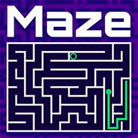

# ⚛️ React Maze 🏃 🕹

A maze game in **2D, 3D and first person**, built with React, TypeScript and three.js. Find the door in as few moves as you can, collect bonus items, earn coins and buy powers. Works offline.

<a href="https://react-maze.vercel.app/">View demo</a>



## Features

- **15 levels in three views**: 2D board, 3D (third-person camera) and first person, each with Easy, Medium, Hard, Expert and Impossible.
- **Level progression**: finish a level and go straight to the next one. 2D leads into 3D, then first person.
- **Fresh mazes**: Expert and Impossible generate a new maze every game. The others are fixed, so scores are comparable.
- **Fog of war**: Expert limits your vision. Impossible only reveals the map as you explore it.
- **Bonus items** hidden at the end of side paths (never on the solution path), from Hard upwards.
- **Coins, XP and a shop** of powers you can use during a game.
- **Leaderboards**: your own records (stored on the device) and a global leaderboard (Firebase).
- **Offline mode**: after one visit the whole game, including 3D, works without a connection.
- Touch controls on mobile.

## How to play

| | 2D and 3D | First person |
|---|---|---|
| <kbd>↑</kbd> / <kbd>W</kbd> | Move north | Walk forward |
| <kbd>↓</kbd> / <kbd>S</kbd> | Move south | Walk back |
| <kbd>←</kbd> / <kbd>A</kbd> | Move west | Turn left 90° |
| <kbd>→</kbd> / <kbd>D</kbd> | Move east | Turn right 90° |
| <kbd>1</kbd>–<kbd>4</kbd> | Use a power | Use a power |

In first person a minimap in the corner shows only the cells you have already seen.

### Levels

| | 2D | 3D | First person |
|---|---|---|---|
| Easy | 12×12 | 15×15 | 11×11 |
| Medium | 19×19 | 19×19 | 15×15 |
| Hard | 27×27 · items | 23×23 · items | 19×19 · items |
| Expert | 31×31 · fog · new maze | 27×27 · fog · new maze | 23×23 · dark · new maze |
| Impossible | 41×41 · reveals as you go · new maze | 35×35 · reveals as you go · new maze | 27×27 · pitch black · new maze |

### Bonus items

| Item | Effect |
|---|---|
| 💎 Gem | +150 points |
| ⏳ Hourglass | −12 moves |
| 👣 Ghost boots | Your next 30 steps back onto visited cells are free |

Going after an item costs moves, so you have to decide whether the detour is worth it.

### Score

```
Score = 1000 + bonus points − 10 × (moves over the shortest path)
```

The same formula works on fixed and generated mazes. Using hourglasses you can finish under the shortest path and score above 1000.

### Coins and powers

You earn coins and XP when you finish a level. Harder levels pay more, with small bonuses for a high score, your first clear of a level and a perfect run. Spend coins in the shop (🛒 on the menu):

| Power | Price | Effect |
|---|---|---|
| ⚡ Super speed | 40 | Next 8 moves run to the next junction for the cost of one |
| 🔦 Lantern | 30 | +2 vision for the rest of the level (fog and dark levels) |
| 🧭 Compass | 50 | Shows the next cells of the way out for 12 moves |
| 👣 Ghost boots | 25 | Your next 30 steps back are free |

Coins, XP, powers and personal records are stored in the browser (localStorage), so they work offline but stay on that device.

## Built with

- [React](https://react.dev/) 17 + [TypeScript](https://www.typescriptlang.org/)
- [Vite](https://vite.dev/) for development and builds, [Vitest](https://vitest.dev/) + Testing Library for tests
- [three.js](https://threejs.org/) for the 3D and first-person views (loaded only when needed)
- [styled-components](https://styled-components.com/)
- [Firebase](https://firebase.google.com/) Firestore for the global leaderboard
- A service worker generated at build time for offline play

## Getting started

### Prerequisites

- Node.js 24
- Yarn 1 (`npm install --global yarn`)

### Installation

```bash
# Clone the repository
git clone https://github.com/musoxvi/react-maze.git
cd react-maze

# Install dependencies
yarn install

# Create your environment file and fill in your Firebase project's values
cp env.example .env
```

### Environment variables

The global leaderboard uses Firebase. Create a web app in your Firebase project, enable Firestore and copy its config into `.env`:

```bash
REACT_APP_FIREBASE_KEY=
REACT_APP_FIREBASE_AUTH_DOMAIN=
REACT_APP_FIREBASE_PROYECT_ID=
REACT_APP_FIREBASE_STORAGE_BUKET=
REACT_APP_FIREBASE_MESSAGING_SENDER_ID=
REACT_APP_FIREBASE_APP_ID=
```

The names must match exactly, including the spelling of `PROYECT` and `BUKET`. Without these values the game still works; only the global leaderboard is unavailable.

### Scripts

| Command | What it does |
|---|---|
| `yarn start` | Start the dev server at http://localhost:5173 |
| `yarn build` | Type-check and build for production into `build/` |
| `yarn preview` | Serve the production build locally (offline mode only works here, not in `yarn start`) |
| `yarn test` | Run the tests in watch mode (`yarn test --run` for a single run) |

## Project structure

```
src/
├── components/
│   ├── GameBoard/     # 2D board and player
│   ├── Maze3D/        # three.js scene, 3D character, items and minimap
│   ├── Modal/
│   └── ui/            # shared buttons, cards and background
├── constants/
│   ├── levels.ts      # level list, sizes, fog and items per level
│   └── powers.ts      # shop powers and their prices
├── containers/
│   ├── Game/          # game screen: HUD, controls, win modal
│   └── StartGame/     # menu, level picker, high scores and shop
├── contexts/Maze/     # game state (reducer): moves, items, powers, fog
├── service/           # Firebase scores, local records and wallet
└── utils/             # maze generator, shortest path, item placement
offline/sw.template.js # service worker template (filled in at build time)
```

## Deployment

The project deploys on [Vercel](https://vercel.com/). `vercel.json` sets the output directory to `build/` and makes sure the service worker is never cached, and `package.json` pins Node 24 through `engines`. Add the `REACT_APP_FIREBASE_*` variables in your Vercel project settings.

## License

[MIT](https://choosealicense.com/licenses/mit/)
